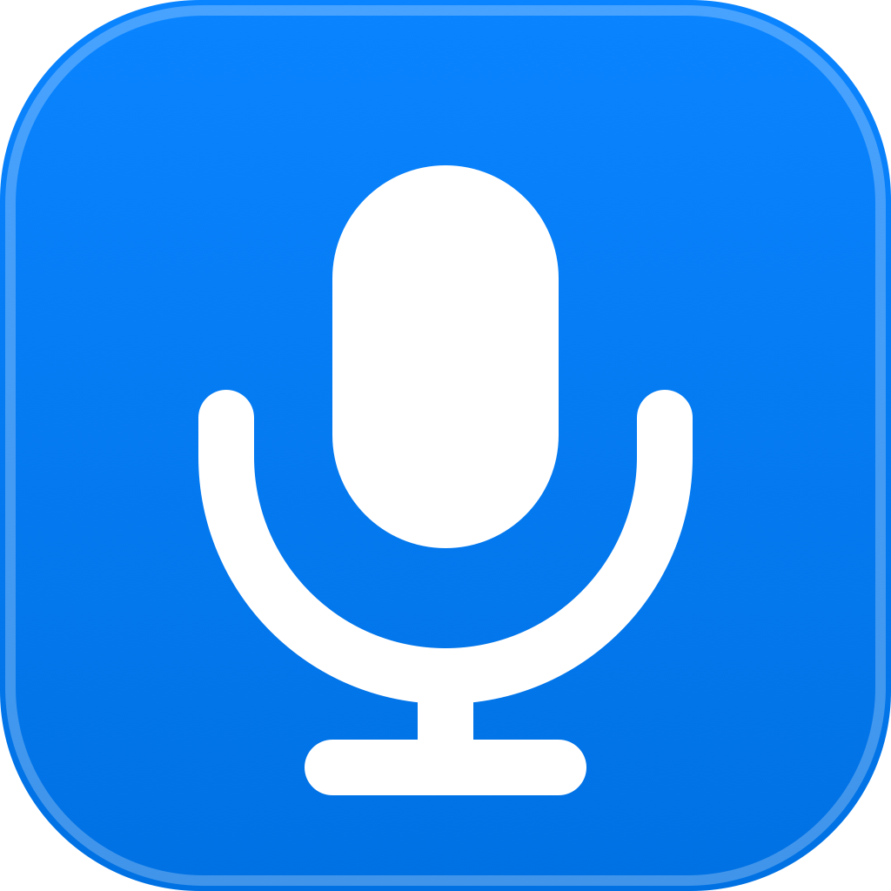

<p align="center">
  
</p>

<h1 align="center">MacVoice — Type at the Speed of Thought</h1>

<p align="center">
  <strong>The ultra-lightweight, local-first voice keyboard for macOS.</strong><br>
  Speak naturally and watch clean, punctuated text appear at your cursor in real time.<br>
  Works in any app · Types even where copy-paste is blocked · Removes "ums" automatically · Zero cloud servers.
</p>

<p align="center">
  <a href="https://macvoice.app"></a>
  <a href="https://macvoice.app/pricing"></a>
  
  
</p>

---

## 💡 Why MacVoice?

Typing all day is exhausting. Your brain moves at **150+ words per minute**, but fingers can only type at 40–60 WPM. 

Existing dictation tools are frustrating:
- **Cloud apps (Wispr, etc.)** charge you **$144/year**, upload your private voice to cloud GPUs, and use a lazy clipboard hack (`Cmd+V`) that wipes whatever code or password you had copied.
- **Built-in Apple Dictation** writes down every vocal hesitation ("um", "uh"), has no chat safety, and frequently drops letters in developer editors.
- **Heavy local AI tools** bundle gigabytes of models, eat up 1.5 GB of RAM, and heat up your laptop.

**MacVoice solves all of this.** It is a pure native Swift utility (784 KB DMG, ~60 MB RAM) that collaborates directly with macOS WindowServer at the hardware level.

---

## ⚡ The Four Superpowers

### 1. ⌨️ Genuine Keyboard Keystrokes (Not a Clipboard Paste Hack)
Most voice tools simply copy transcribed text to your system clipboard (`NSPasteboard`) and press `Cmd+V`. 
- **The problem:** When you type into secure enterprise forms, banking portals, online exam platforms, or remote desktops (Citrix/VDI) where paste is disabled (`onpaste="return false;"`), **those tools fail completely**. Plus, they wipe your clipboard history.
- **The MacVoice difference:** MacVoice synthesizes authentic hardware key-down/up event pairs via macOS Quartz HID (`CGEvent` directly posted to `.cghidEventTap`). To any website or desktop app, it is indistinguishable from physical fingers typing on an Apple Magic Keyboard. **It works everywhere, bypasses paste blocks, and leaves your clipboard untouched.**

### 2. 🚀 Zero Waiting (<150ms Real-Time Streaming)
No waiting around for an AI audio recording to finish processing. Words stream progressively into your focused text field character-by-character the moment you utter each syllable.

### 3. 🪄 Instant Filler Removal (<0.1ms Native Swift Polish)
We all pause and hesitate when speaking. MacVoice's native Swift polisher automatically strips hesitations ("um", "uh", throat clears), fixes unpunctuated contractions ("dont" → "don't"), and formats proper sentence capitalization in less than 0.1 milliseconds with 0 extra RAM.

### 4. 💬 Chat-Safe Typing (Never Accidental Sends in Slack)
Saying "new line" in Slack, WhatsApp, Teams, or Discord usually presses Enter and accidentally fires an unfinished message. MacVoice intelligently recognizes chat apps and automatically injects a safe `Shift + Return` line break, keeping your drafts safe.

---

## 📊 Objective Benchmark Comparison

| Capability | MacVoice (macOS) | Apple Built-in Dictation | Wispr Flow | Superwhisper |
| :--- | :--- | :--- | :--- | :--- |
| **How Words Are Typed** | **Real Keystrokes (Quartz CGEvent)** | Accessibility insertion | Clipboard paste (`Cmd+V`) | Clipboard paste (`Cmd+V`) |
| **Works Where Paste is Blocked** | **Yes (Immune to restrictions)** | Partial | ❌ Fails completely | ❌ Fails completely |
| **Overwrites What You Copied?** | **Never (Clipboard safe)** | Never | ❌ Overwrites clipboard | ❌ Overwrites clipboard |
| **Removes "Um" & "Uh" Hesitations** | **Instant (<0.1ms Swift)** | ❌ None (types stutters) | Cloud AI LLM | Local LLM |
| **Typing Latency** | **< 150ms Live Streaming** | ~200ms | ~1.0s cloud loop | 2.5s batch wait |
| **Safe in Slack / WhatsApp / Teams** | **Yes (Chat-Aware Shift+Return)** | ❌ Sends message early | ❌ Sends message early | ❌ Sends message early |
| **Voice Privacy** | **100% On-Device (0 bytes cloud)** | Apple Cloud / Local | Cloud server GPUs | 100% On-Device |
| **App Size & Memory** | **784 KB (~60 MB RAM)** | Built-in | ~80 MB (~180 MB RAM) | 1.5 GB+ (500 MB–1.8 GB RAM) |
| **Pricing Model** | **$9 USD One-Time (Own forever)** | Free with macOS | $144 / year subscription | $250 lifetime |

---

## 🎬 Two Dictation Modes

Switch seamlessly with a single click:
- **Verbatim Mode (Raw Speed):** Direct speech-to-text path with minimal processing. Ideal for coding, shell commands, variable names, and technical terms.
- **Polished Mode (Smart Cleanup):** In-process Swift grammar normalization. Strips vocal fillers, fixes contractions, and ensures publication-ready prose for Slack, emails, and notes.

---

## 🔒 Privacy by Architecture (Not Just Policy)

- **0 Bytes Outbound Network Traffic:** Links only to native Apple system frameworks (`AppKit`, `Speech`, `CoreGraphics`, `Carbon`). Contains zero tracking SDKs, zero analytics, and zero external network calls.
- **In-Memory Audio Processing:** Audio PCM buffers are processed live in resident RAM and wiped immediately. Zero audio files are ever written to disk, cache, or `/tmp`.
- **Zero Dictation History:** MacVoice acts as an input keyboard, not a note-taking app. It retains no logs or database of what you say.

---

## 🚀 30-Second Quickstart

1. **Download:** Grab `MacVoice.dmg` (784 KB) from your [purchase confirmation page](https://macvoice.app/pricing).
2. **Install:** Double-click and drag **MacVoice.app** into your `/Applications` folder.
3. **Grant Permissions:** Approve standard macOS prompts for **Microphone** (to transcribe audio locally) and **Accessibility** (to type simulated keystrokes into other apps).
4. **Speak:** Click into any text field in VS Code, Slack, Word, or Safari, press <kbd>Control</kbd> + <kbd>Option</kbd> + <kbd>Space</kbd>, and begin speaking!

---

## 🛠 Repository & Website Architecture

This repository powers the official marketing and checkout platform for MacVoice:

- **Framework:** Next.js 16 (App Router) + React 19 + TypeScript
- **Styling:** Tailwind CSS v4 + Apple Pure White Design System (`#FFFFFF`, `#F5F5F7`, `#E8E8ED`, `#0071E3`)
- **Checkout & Licensing:** Stripe Checkout integration verifying server-side payments and issuing tamper-proof HMAC-SHA256 download tokens for `MacVoice.dmg`
- **Interactive Simulators:** Dual-window macOS simulator with real-time text streaming and native control window

### Local Development

```bash
# Clone the repository
git clone https://github.com/Akshatthakur22/Macvoice-dev.git
cd Macvoice-dev

# Install dependencies
pnpm install

# Start local development server
pnpm dev
```

Open [http://localhost:3000](http://localhost:3000) to view the live website.

---

## 👨‍💻 Created by

Crafted with care by **Akshat Thakur**.

- **Portfolio:** [akshatt.in](https://akshatt.in/)
- **GitHub:** [@Akshatthakur22](https://github.com/Akshatthakur22)
- **LinkedIn:** [linkedin.com/in/akshatthakur22](https://www.linkedin.com/in/akshatthakur22/)
- **Contact:** [akshatthakur22@gmail.com](mailto:akshatthakur22@gmail.com)

---

<p align="center">
  <sub>© 2026 MacVoice. Built for software engineers, writers, and Mac power users. Apple, Mac, and macOS are trademarks of Apple Inc.</sub>
</p>
